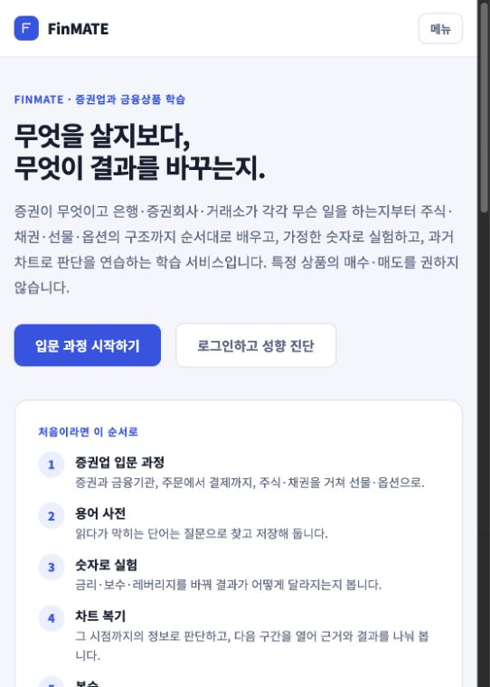
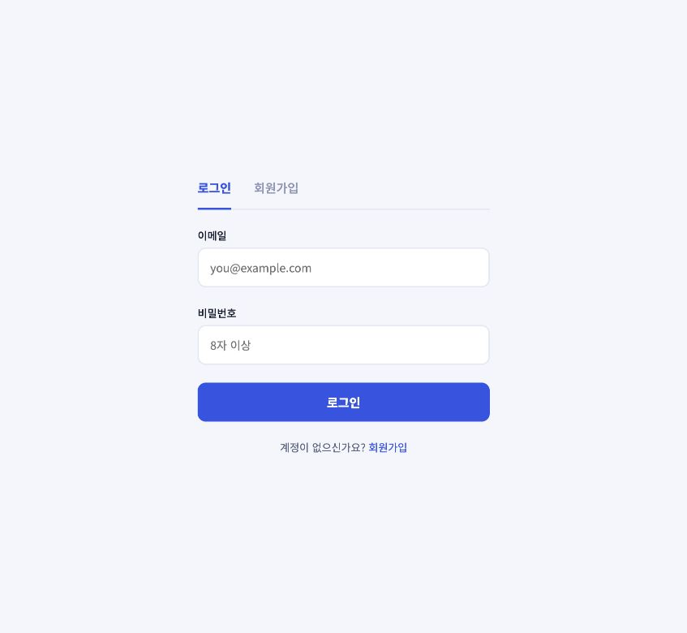

# FinMATE 프런트 고도화

작업일: 2026-10-27 · 작업 브랜치: `wp12-frontend-identity`

## 디자인 방향

**친숙하고 아기자기한 금융 공부방.** 현재 메인은 원래의 오렌지색 책 건물과 함께 배우는 사람들의 일러스트를 유지한다. 왼쪽 제목 ‘나의 첫 금융 공부’와 본문·버튼·입력은 Pretendard로 통일한다. 제목은 굵기 680으로 선명하게 잡고, 주식·채권·ETF 중 궁금한 주제를 고르는 작은 질문 노트를 더해 실제 학습으로 연결한다. 캠퍼스와 밝은 두 열 배치는 그대로 두고, 여백·종이색·작은 책 모양으로 내용을 풍성하게 만든다. 저녁 금융가·서재를 전면 배경으로 사용한 4차 시안은 사용자 피드백에 따라 롤백했다. 홈과 로그인은 같은 캠퍼스 일러스트를 사용한다.

아이보리 종이색, 짙은 초록색 본문, 오렌지 포인트를 사용했다. 핵심 행동은 짙은 오렌지 버튼, 보조 행동은 텍스트 링크로 구분한다. 설명을 짧게 나누고 여백과 글자 크기로 읽는 순서를 만든다. 현재 홈 하단은 넓은 과정·실습 본문과 좁은 용어·바로가기 보조 열로 구성한다.

## As-is / To-be

| 항목 | As-is | To-be | 바꾼 이유 |
|---|---|---|---|
| 첫인상 | 파란색 F 심볼, 긴 설명과 학습 순서 카드. 6차에서는 얇은 고운돋움 제목 옆이 허전함 | 책과 두 사람을 결합한 워드마크, 기존 캠퍼스, Pretendard 제목과 직접 고르는 질문 노트 | 친숙한 정체성과 짧은 문구를 유지하며 읽는 순서와 실제 참여 요소를 추가 |
| 홈 정보 구조 | 기능 설명, 학습 순서, 모델 지표, 서비스 범위가 비슷한 무게 | 브랜드 소개 → 넓은 과정·도구 본문 + 좁은 용어·바로가기 열 | 주 콘텐츠와 보조 정보를 구분하고 학습 시작 위치를 명확히 표시 |
| 주요 행동 | 입문 과정과 진단을 비슷한 버튼으로 제공 | 입문 과정은 주 버튼, 성향 진단은 보조 링크 | 금융 교육이라는 중심 목적에 맞춰 행동의 우선순위 표시 |
| 기능 탐색 | 제목·문단 위주의 동일한 카드. 이후 과정 표의 배치만 정리되어 표현이 단조로움 | 책을 닮은 과정 제목, 순서를 보여 주는 단계 선택, 읽기 쉬운 목차 표, 종이색 용어 노트와 작은 도구함 | 실제 내용과 기존 배치는 유지하면서 영역별 역할과 선택 상태를 명확히 표시 |
| 로그인 | 큰 그림이 잘리고 입력 폼이 아래로 멀리 내려감 | 화면 높이에 맞는 캠퍼스, 위로 올린 로그인·회원가입 폼, 아래의 공개 과정·용어 사전 링크 | 로그인과 가입을 가까이 모으고 데스크톱에서 한 화면에 담을 수 있도록 높이 조절 |
| 모바일 | 기존 반응형 규칙에 의존 | 960px 이하에서 보조 열을 본문 아래로, 600px 이하에서는 단계 선택을 2×2로 표시. 모바일 로그인은 큰 그림을 숨기고 워드마크·폼 표시 | 화면 폭에 맞춰 읽는 순서와 조작 영역 유지 |
| 서체 | Noto Sans KR 본문과 제목 전용 Google Fonts 요청 | 공식 Pretendard 가변 WOFF2를 로컬 제공하고 화면 전반에 적용 | 제목과 본문의 일관성을 높이고 외부 폰트 요청 의존 제거 |
| 공통 스타일 | 파란색 계열의 개별 배경·테두리 | CSS 변수로 색상 통일, 학습 화면에도 같은 토큰 적용 | 이후 수정 비용과 화면 간 편차 감소 |
| 접근성 | 포커스·폼 레이블이 일부 부족 | 키보드 포커스, label/id, 자동완성, 오류 알림, 펼침 상태, 동작 감소 설정 | 마우스·키보드·보조 기술로 모두 조작 가능 |
| 이미지 | 서비스 고유 비주얼 없음 | 홈·로그인에 투명 캠퍼스 WebP 사용. 비율 지정과 우선 로딩 | 브랜드 표현과 초기 표시 비용의 균형 |

홈에서 모델 성능 수치와 추상적인 3단계 학습 여정은 제외했다. 모델 평가 결과와 한계는 헤더·푸터의 모델 안내 링크로 확인한다. 과정의 단계·개념 수, 목차와 용어의 정의·계산식·예시는 실제 API 응답을 사용한다.

## 화면 비교

동일한 브라우저 창 크기에서 기존 HEAD를 임시 디렉터리로 실행해 수정 전 화면을 기록했다.

| 화면 | 수정 전 | 수정 후 |
|---|---|---|
| 홈 |  |  |
| 학습 영역 | [3차 과정·도구 본문](screenshots/home-board-v3.png) |  |
| 로그인 |  |  |

## 반복 카드에 대한 추가 수정

1차 시안의 동일한 카드 4개, 파스텔 아이콘, 영문 소제목, 추상적인 01·02·03 여정과 AI 성능 수치가 템플릿처럼 느껴진다는 피드백을 반영했다.

- 같은 비중의 카드 4개 → 왼쪽 실제 과정 목차, 오른쪽 용어 노트의 서로 다른 편집 방식.
- 영어 소제목과 홍보 문구 → 실제 단원·개념 제목과 출처가 있는 용어 설명.
- 고정된 기능 소개 → PER·ETF·복리를 눌러 정의와 예시를 바꿔 읽는 미리보기.
- 큰 녹색 배경의 추상적인 학습 여정 → 개념 지도·모의 실험·차트 복기로 이동하는 간결한 목록.
- 홈의 모델 성능 수치 → 모델 실험실에서 상세 확인.

추가 수정 전의 기준은 사용자가 첨부한 동일 크기 기능 카드 4개와 녹색 학습 여정·모델 수치 화면이다.
추가 수정 후: [과정 목차](screenshots/home-learning-v2.png), [용어 노트](screenshots/home-glossary-v2.png). 추가 수정 후 사진은 좁은 폭의 인앱 브라우저에서 촬영했다.

## 포털 배치를 적용한 3차 수정

사용자가 추가한 참고 화면에서 넓은 주 콘텐츠 열, 좁은 오른쪽 보조 열, 표와 구분선으로 정보를 정렬하는 방식을 가져왔다. 첫 화면의 캠퍼스 일러스트와 브랜드 색상은 유지하고 학습 영역의 정보 배치를 바꿨다. 시세·환율·등락률 데이터는 추가하지 않았다.

- 왼쪽 본문에는 입문 과정과 실습·복습 도구를 배치한다. 과정은 API가 제공하는 네 단계를 선택하고 각 단계의 개념명·요약·확인 문제 수를 표에서 살펴볼 수 있다.
- 오른쪽 보조 열에는 PER·ETF·복리 미리보기, 진단·이력·모델 안내 링크, 로그인 상태에 따른 학습 기록 진입을 모은다.
- 표의 문제 수와 과정 단계·개념 수는 실제 API 응답을 사용하며, 각 개념은 학습 화면으로 연결한다. 로딩·오류·공개된 개념이 없는 상태도 구분한다.
- 960px 이하에서는 보조 열을 본문 아래로 내려 읽는 순서를 유지한다. 단계 버튼은 좁은 화면에서 줄바꿈한다.

3차 수정 화면: [과정·도구 본문](screenshots/home-board-v3.png), [용어·바로가기 보조 열](screenshots/home-sidebar-v3.png). 사진은 좁은 폭의 인앱 브라우저에서 촬영했으며, 넓은 화면에서는 두 열로 표시한다.

## 메인 문구·분위기를 조정한 4차 시안 — 롤백

‘알수록 든든한 금융, 함께 배우는 즐거움.’의 대칭적인 두 줄 홍보 문구가 인위적으로 느껴진다는 피드백을 반영했다. 제목은 **‘증권의 문법’**이라는 짧은 명사형으로 바꾸고, 보조 문장은 ‘주식과 채권, 시장이 움직이는 구조를 공부합니다.’로 정리했다.

- 굵은 산세리프 두 줄·색상 분할·밑줄 장식을 제거하고 제목에만 가벼운 명조 계열을 사용했다.
- 작은 장식 배지와 점선 원을 걷어내고, 저녁 금융가를 바라보는 서재 장면을 메인 프레임에 담았다.
- 장면 위의 글자는 HTML 텍스트로 유지하고 CSS 음영으로 대비를 확보한다. 이미지 안에 문구를 구워 넣지 않았다.
- 상단 영역만 바꿨으며 3차 포털 배치와 실제 학습 진입 경로는 유지했다.

[4차 시안 기록](screenshots/home-hero-v4.png). 이 화면은 현재 서비스에 사용하지 않는다.

## 캠퍼스를 복원하고 제목만 조정한 5차 수정

사용자의 요청은 원래 캠퍼스 이미지를 유지하면서 글자 표현을 바꾸는 것이었다. 이에 따라 전면 저녁 배경을 제거하고 밝은 두 열 배치, 오렌지색 캠퍼스, 점선 원과 작은 배지를 복원했다. 하단의 3차 포털 배치는 유지한다.

- 제목은 **‘증권의 문법’**을 한 줄 명조체로 표시한다. 대칭적인 두 줄 슬로건, 색상 분할, 밑줄 장식은 사용하지 않는다.
- 보조 문장은 ‘주식과 채권, 시장이 움직이는 구조를 공부합니다.’로 유지한다.
- 기존 오렌지색 주 버튼과 짙은 본문 색상으로 돌아간다. 어두운 배경용 음영·밝은 글자·아이보리 버튼 규칙은 제거했다.
- 저녁 장면 파일은 시안 기록으로 보관하며 현재 홈에서는 요청하지 않는다.

[5차 메인 화면 기록](screenshots/home-hero-v5.png).

## 친숙한 문구와 서체로 다듬은 6차 수정

‘친숙하고 아기자기하게, 깔끔함이 중요하다’는 피드백을 반영해 메인 글자 부분만 조정했다. 캠퍼스 이미지와 밝은 배치, 하단의 과정·용어 포털은 유지한다.

- 제목은 **‘나의 첫 금융 공부’**, 작은 안내는 ‘FinMATE · 금융 공부방’으로 바꿨다.
- 설명은 ‘주식과 채권의 기초부터 하나씩 알아봐요.’라는 짧은 문장으로 정리했다.
- 제목에만 `Gowun Dodum` 400을 적용했다. 제목 크기는 넓은 화면에서 34~56px, 740px 이하에서 32~42px, 360px 이하에서 30px로 조정한다.
- 제목은 짙은 초록 한 색으로 표시하고 새 장식은 추가하지 않는다. 기존 그림의 작은 인물·책·배지가 아기자기한 인상을 이어 간다.

[6차 메인 화면](screenshots/home-hero-v6.png).

## Pretendard·질문 노트·학습 포털·로그인을 다듬은 7차 수정

‘깔끔함을 유지하면서 더 풍성하게’, ‘서체는 프리텐다드로’, ‘로그인과 회원가입을 위로 올리고 한 화면에서 볼 수 있게’라는 피드백을 반영했다. 캠퍼스 이미지를 바꾸거나 하단의 정보 배치를 전면 교체하지 않고, 기존 요소의 표현과 화면별 크기 조절을 개선했다.

- **서체:** 제목 전용 고운돋움과 기존 Google Fonts 요청을 제거했다. 공식 Pretendard 가변 폰트를 로컬에서 제공하며 제목은 680, 본문·버튼·입력은 역할에 맞는 굵기를 사용한다. `finmate.` 워드마크의 로고 서체는 기존 형태를 유지한다.
- **홈 왼쪽:** 제목·설명·행동 버튼의 크기와 간격을 조정하고 ‘먼저, 궁금한 것부터’ 질문 노트를 추가했다. 주식·채권·ETF 버튼을 누르면 질문과 설명이 바뀌며, 해당 개념을 실제 학습 화면에서 읽을 수 있다. 자동으로 움직이는 장식이나 가짜 진행률은 추가하지 않았다.
- **금융 학습 한눈에 보기:** 과정은 책을 닮은 제목과 순서가 있는 단계 선택으로, 용어는 종이색 작은 노트로, 실습은 아이콘이 있는 도구함으로 구분한다. 선택된 단계의 색과 밑줄, 목차 행의 번호·문제 수, 용어의 계산식·예시를 정돈했다. 단계 표시는 공개 과정의 순서이며 사용자가 완료한 진척률을 의미하지 않는다.
- **로그인·회원가입:** 폼을 위로 올리고 제목·탭·입력·버튼을 가까이 모았다. 왼쪽 캠퍼스는 가용 높이 안에서 원래 비율로 모두 표시한다. 낮은 노트북 화면에서는 여백을 더 줄이며, 오류 문구·확대·아주 작은 화면으로 내용이 늘면 자연스럽게 스크롤해 입력을 가리지 않는다.
- **폼 아래:** 이미 왼쪽에 캠퍼스 이미지가 있으므로 아래에는 실제 사용 가능한 입문 과정·용어 사전 링크를 배치했다. 현재 백엔드에는 OAuth 로그인 연동이 없어 작동하지 않는 소셜 로그인 버튼을 넣지 않았다. 실제 도입에는 공급자 설정과 콜백·서버 인증 연동이 필요하다.
- **데이터:** 과정·용어의 API, 공개 학습 경로, 로그인·가입 요청과 로그인 후 복귀 동작을 유지한다. 시세·등락률·가상의 통계는 넣지 않았다.

7차 화면: [홈 메인](screenshots/home-hero-v7.png), [금융 학습 영역](screenshots/home-learning-v7.png), [로그인](screenshots/login-v7.png).

## 사용 기술과 원리

### React 19 · TypeScript · React Router

기존 기술 스택을 유지하고 새 라이브러리는 추가하지 않았다. `Brand`는 홈·헤더·로그인의 워드마크를 공유하고 `Icon`은 아이콘 이름을 TypeScript 유니온 타입으로 제한한다. 디자인을 바꿀 때 한 컴포넌트를 수정하면 사용처가 함께 바뀐다.

페이지 이동은 기존 React Router 경로를 사용한다. 공개 학습 화면은 로그인 없이 접근할 수 있고, 보호된 화면에서 로그인으로 이동할 때 `location.state.from`으로 목적지를 전달한다. 로그인 후에는 내부 경로인지 확인해 되돌린다. 홈의 ‘내 학습’과 ‘투자 성향’ 링크도 이 흐름에 맞췄다.

### CSS 변수 · Grid · Flexbox

`src/index.css`의 `:root`가 색상의 원천이다. `--bg`, `--text`, `--primary`, `--primary-tint`, `--surface-soft`를 기존 학습 화면에서도 사용하므로 주제색을 한곳에서 관리한다. 공통 브랜드 규칙은 `src/styles/brand.css`, 7차의 질문 노트·학습 영역·로그인 보정은 `home-hero.css`, `home-learning.css`, `login-refinement.css`로 분리했다.

Grid는 메인의 문구·캠퍼스 두 열과 학습 영역의 본문·보조 열 배치를, Flexbox는 메뉴·버튼·입력 영역처럼 한 방향으로 정렬하는 요소를 담당한다. `minmax(0, 1fr)`로 긴 내용이 열 너비를 강제로 키우는 것을 방지한다.

학습 영역은 넓은 본문과 좁은 보조 열로 나누고, 960px 이하에서는 본문 다음에 보조 정보를 배치한다. 보조 영역 자체는 두 열을 쓰다가 600px 이하에서 한 열로 바뀐다. 단계 선택은 넓은 화면에서 네 열, 600px 이하에서 2×2로 표시한다. 메인은 740px 이하에서 문구 아래에 캠퍼스를 배치하고 이미지의 원래 비율을 유지한다. 360px 이하에서는 행동 버튼을 위아래로 배치한다. 도구 링크는 아이콘·설명·화살표의 열을 정렬하고, 과정은 의미에 맞는 HTML 표를 사용한다. 1180px 이하에서는 메뉴를 접는다.

`clamp()`는 글자 크기와 여백의 최소·최대값을 정해 화면 크기에 따라 부드럽게 조절한다. `100dvh`는 로그인 화면을 현재 보이는 브라우저 높이에 맞춘다. 왼쪽 이미지의 `object-fit: contain`은 그림을 자르지 않고 주어진 공간 안에 담는다. 760px·680px 이하 높이에서는 폼의 간격과 바깥 여백을 줄이고, 740px 이하 폭에서는 큰 그림을 숨기고 워드마크와 입력 폼에 집중한다. 페이지에 `overflow: hidden`을 강제해 내용을 가리는 대신, 내용이 실제로 늘어나는 경우 스크롤을 허용한다.

### 접근성과 상호작용

- 입력마다 `htmlFor`와 `id`로 레이블을 연결하고 이름·계정·현재/새 비밀번호 자동완성 값을 지정했다.
- `:focus-visible`로 키보드 포커스를 표시하고, 오류는 `role="alert"`, 데이터 상태는 `role="status"`로 전달한다.
- 메뉴는 `aria-expanded`/`aria-controls`, 로그인 방식은 `aria-pressed`로 현재 상태를 제공한다.
- 과정 단계와 용어 선택은 `aria-pressed` 버튼으로 선택 상태를 제공한다. 과정 표는 caption과 열·행 제목으로 내용을 연결하고 개념명에 실제 링크를 둔다.
- 첫 질문의 주식·채권·ETF 선택은 React `useState`로 관리한다. `aria-pressed`는 누른 주제를, `aria-live="polite"`는 바뀐 질문 내용을 보조 기술에 전달한다. 마우스를 올려야만 나타나는 내용은 없다.
- 이미지에는 내용에 맞는 대체 텍스트를, 장식 SVG에는 `aria-hidden`을 사용한다.
- `prefers-reduced-motion`에서는 이동·스크롤 효과를 줄인다. 보조 문구와 단계 번호의 명도 대비를 검토해 색을 보정했다.

### 이미지·타이포그래피와 성능

이미지는 Built-in Imagegen으로 제작하고 Pillow로 WebP를 인코딩했다. 실행 중 이미지 생성 API를 호출하지 않는 정적 파일이다.

| 용도 | 서비스 파일 | 크기 | 원본 |
|---|---|---|---|
| 현재 홈·로그인 캠퍼스 | `public/images/finance-campus.webp` | 1536×1024, 141,056 bytes | `docs/design-assets/finance-campus-source.png`, 2,016,345 bytes |
| 보관한 4차 시안 — 현재 미사용 | `public/images/securities-twilight.webp` | 1774×887, 326,320 bytes | `docs/design-assets/securities-twilight-source.png`, 2,593,049 bytes |

현재 캠퍼스 WebP는 PNG 원본보다 약 93% 작다. 보관한 저녁 장면의 생성 프롬프트는 [securities-twilight-prompt.txt](design-assets/securities-twilight-prompt.txt)에 남겨 두었다. 이 시안 이미지는 현재 화면에 표시하지 않는다.

메인 이미지의 실제 `width`/`height`, 컨테이너의 최소 높이를 지정해 이미지 로딩으로 배치가 흔들리지 않게 했고 `fetchPriority="high"`로 우선 로딩한다. 투명 캠퍼스 이미지를 밝은 배경 위에 원래 비율로 표시한다. 로고와 작은 아이콘은 SVG이므로 크기가 바뀌어도 선명하다.

현재 서체는 공식 [Pretendard v1.3.9](https://github.com/orioncactus/pretendard/releases/tag/v1.3.9)의 [가변 WOFF2](https://github.com/orioncactus/pretendard/blob/v1.3.9/packages/pretendard/dist/web/variable/woff2/PretendardVariable.woff2)를 `public/fonts/PretendardVariable.woff2`에 저장해 자체 제공한다. 실제 파일은 **2,057,688 bytes**이며, [라이선스·저작권 고지](../public/fonts/Pretendard-LICENSE.txt)도 함께 배포한다. SIL OFL 1.1을 따른다. CSS `@font-face`의 이름은 `Pretendard`, 굵기 범위는 `45 920`이다. 가변 폰트 하나로 여러 굵기를 표현하며, 제목의 680 같은 중간 굵기도 사용할 수 있다.

Google Fonts의 외부 CSS·폰트 요청은 제거했다. `font-display: swap`으로 다운로드 중에는 시스템 글꼴로 먼저 읽을 수 있게 한다. 로컬 제공은 외부 CDN 의존을 줄이지만 이번 파일은 전체 글리프를 포함한 약 2MB 파일이므로 필요한 글자만 받는 서브셋보다 항상 작다는 의미는 아니다. 실제 Core Web Vitals나 Lighthouse 점수는 이번 작업에서 측정하지 않았다.

1차 캠퍼스 생성 프롬프트 기록: “Polished handcrafted miniature finance learning campus diorama on genuinely transparent background. Orange stair-step building inspired by a thick open book, cream library alcove, three friendly students reading and discussing a simple bar chart, sage trees and miniature books. Sophisticated soft 3D clay and crafted paper, tactile matte ceramic finish, warm studio daylight, isometric 3/4 view, landscape 3:2 composition. Palette ivory #f8f7f2, forest #203d35, orange #f2733b, sage #c7d5bd. No text, numbers, currency symbols, logos, labels or watermark.”

### API 상태 처리

입문 과정은 `api.getCourse("securities-intro")`, 용어는 `api.getGlossaryTerm(slug)`으로 조회한다. 컴포넌트가 사라진 뒤에는 응답으로 상태를 갱신하지 않도록 effect 정리 함수의 `current` 플래그로 방지한다. 용어를 바꾸면 `key`로 본문 컴포넌트를 새로 마운트해 이전 용어의 본문과 요청 상태가 섞이지 않게 한다. 로딩과 실패 상태도 표시한다. 과정 목차는 실제 `/learn?concept=...`로, 용어는 실제 상세 페이지로 이동한다.

## 로컬 실행

확인 주소: **http://127.0.0.1:5180/**

기존 5173·5174·8080 포트를 사용하는 다른 실행 환경은 유지하고, 현재 체크아웃의 API를 8081에 별도로 실행했다. 개발 세션에서 5180/8081 서버는 계속 실행한다.

백엔드 터미널에서:

```sh
cd /Users/minkyu/MK/domain-study/oh-my-finance/omf-backend
FINMATE_CORS_ALLOWED_ORIGINS=http://127.0.0.1:5180,http://localhost:5180 \
  mvn spring-boot:run -Dspring-boot.run.arguments=--server.port=8081
```

프런트 터미널에서:

```sh
cd /Users/minkyu/MK/domain-study/oh-my-finance/omf-frontend
API_PROXY_TARGET=http://127.0.0.1:8081 VITE_API_BASE_URL=/api \
  npm run dev -- --host 127.0.0.1 --port 5180 --strictPort
```

Vite는 브라우저의 `/api` 요청을 8081로 전달한다. API 주소와 CORS 허용 주소는 실행 환경으로 설정했고 API 계약과 백엔드 소스는 변경하지 않았다. 기본 H2 메모리 DB이므로 이 로컬 API를 재시작하면 계정과 학습 기록이 초기화된다.

## 검증

아래는 1~4차 작업에서 수행한 검증 기록이다. 이후 수정의 검증 결과는 차수별로 별도 기록한다.

- TypeScript 및 Vite 프로덕션 빌드 통과.
- 전체 `npm run lint` 통과. 기존 파일의 effect/fast refresh 관련 경고는 남아 있으며, 변경한 TSX 파일의 개별 lint는 통과했다.
- Playwright 데스크톱·모바일 **14개 통과**: 화면 가입·학습·퀴즈 채점, 진단·이력, 입문 과정 진척, 차트 복기, 계정 변경·탈퇴, 페이지 제목·없는 주소, 모바일 8개 경로의 새로고침·가로 넘침 확인.
- 브라우저에서 홈·메뉴 펼침·로그인·입문 과정을 실제 확인하고 스크린샷을 저장했다. 추가 수정 후 PER→ETF→복리 전환과 용어 상세 진입을 직접 확인했다.
- 3차 수정 후 기존 테스트 14개를 다시 통과했다. 브라우저에서 4개 과정 단계를 모두 선택해 목차·문제 수·학습 목표가 바뀌는 것과 용어 전환을 확인했다.
- 4차 메인 조정 후 빌드·lint 및 페이지 이동·모바일 8개 경로 테스트 **9개 통과**. 실제 브라우저에서 새 제목과 메인 이미지의 표시를 확인했다.
- `git diff --check` 통과.

5차 롤백 후 `npm run lint`, `npm run build`(64개 모듈), `git diff --check`를 통과했다. 기존 데스크톱 페이지 이동 및 모바일 경로 새로고침·가로 넘침 테스트 **9개가 통과**했다(3.5초). 현재 화면은 [5차 메인 스크린샷](screenshots/home-hero-v5.png)에 기록했다.

6차 문구·서체 수정 후 `npm run lint`(기존 학습·관리 화면 경고 유지), `npm run build`, `git diff --check`를 통과했다. 변경한 홈에 해당하는 기존 모바일 새로고침·가로 넘침 테스트 **1개가 통과**했다. 실제 브라우저에서 제목·설명·기존 캠퍼스를 확인하고 [6차 화면](screenshots/home-hero-v6.png)을 저장했다.

처음 검증에서는 기존 8080 컨테이너의 오래된 API와 다른 허용 Origin 때문에 5개가 실패했다. Trace에서 `403 Invalid CORS request`와 누락된 과정·복기 API를 확인했고, 현재 소스의 별도 API로 연결한 후 14개가 모두 통과했다. 관리자 게시 테스트와 운영 배포는 실행하지 않았다.

재실행:

```sh
cd /Users/minkyu/MK/domain-study/oh-my-finance/omf-e2e
BASE_URL=http://127.0.0.1:5180 npx playwright test --project=desktop --project=mobile
```

## 주요 변경 파일

- `src/components/Brand.tsx`, `Icon.tsx`: 재사용 브랜드·아이콘.
- `src/components/Header.tsx`: 공통 워드마크·반응형 메뉴.
- `src/pages/HomePage.tsx`, `src/components/HomeLearning.tsx`: 홈 구조, 공개 과정 목차, 용어 미리보기와 실제 학습 진입.
- `src/pages/LoginPage.tsx`: 브랜드 레이아웃·폼 접근성.
- `src/index.css`, `src/styles/brand.css`: 공통 토큰·브랜드·Pretendard·기본 반응형 규칙.
- `src/styles/home-hero.css`, `src/styles/home-learning.css`, `src/styles/login-refinement.css`: 질문 노트·학습 포털·화면 높이에 따른 로그인 보정.
- `public/favicon.svg`, `public/images/finance-campus.webp`: 현재 서비스 자산. `public/images/securities-twilight.webp`는 미사용 시안 기록.
- `public/fonts/PretendardVariable.woff2`, `public/fonts/Pretendard-LICENSE.txt`: 공식 가변 폰트와 동봉한 라이선스.
- `index.html`: 브라우저 테마 색상.

이번 작업에서 전면 재구성한 화면은 홈과 로그인이다. 나머지 학습·진단 화면은 공통 헤더·색상·폼·버튼 스타일을 적용했으며 개별 업무 로직은 유지했다.
